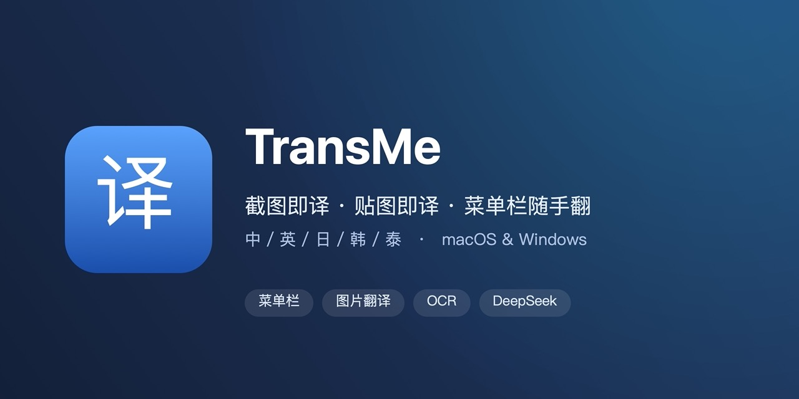
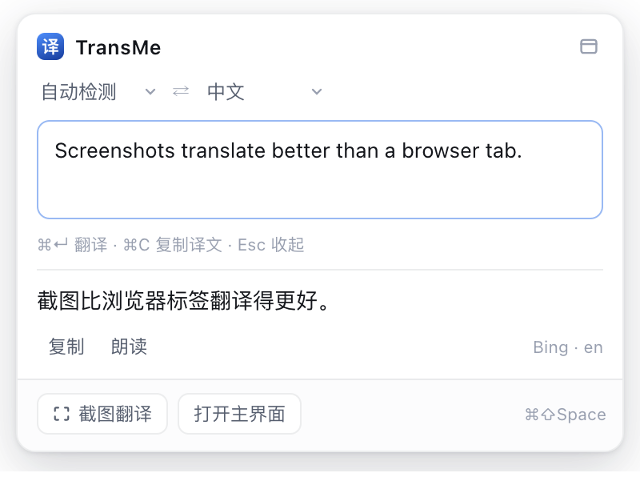
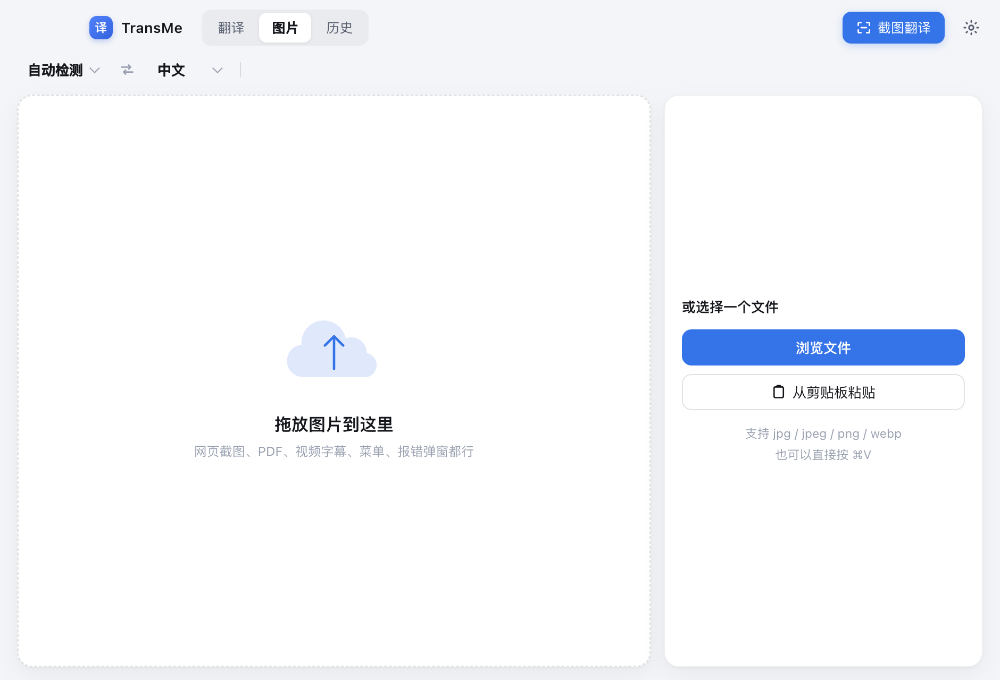
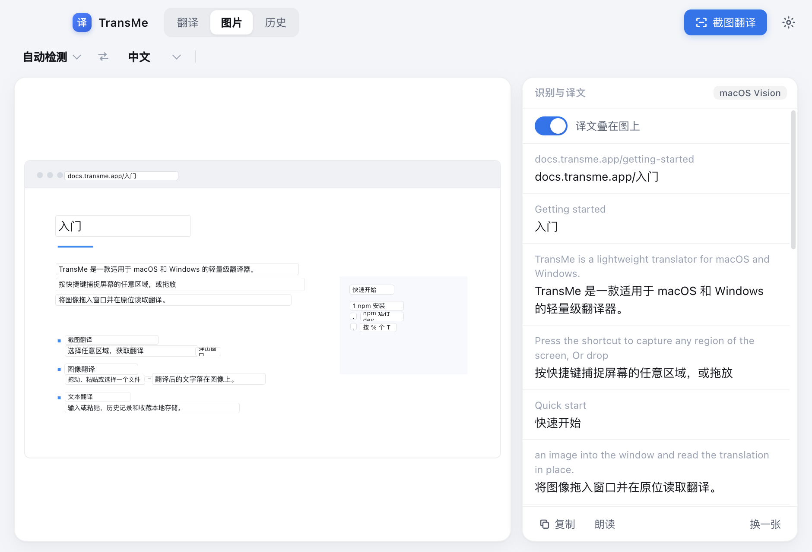
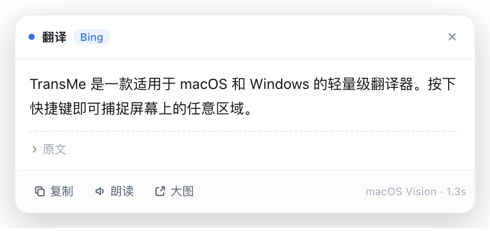
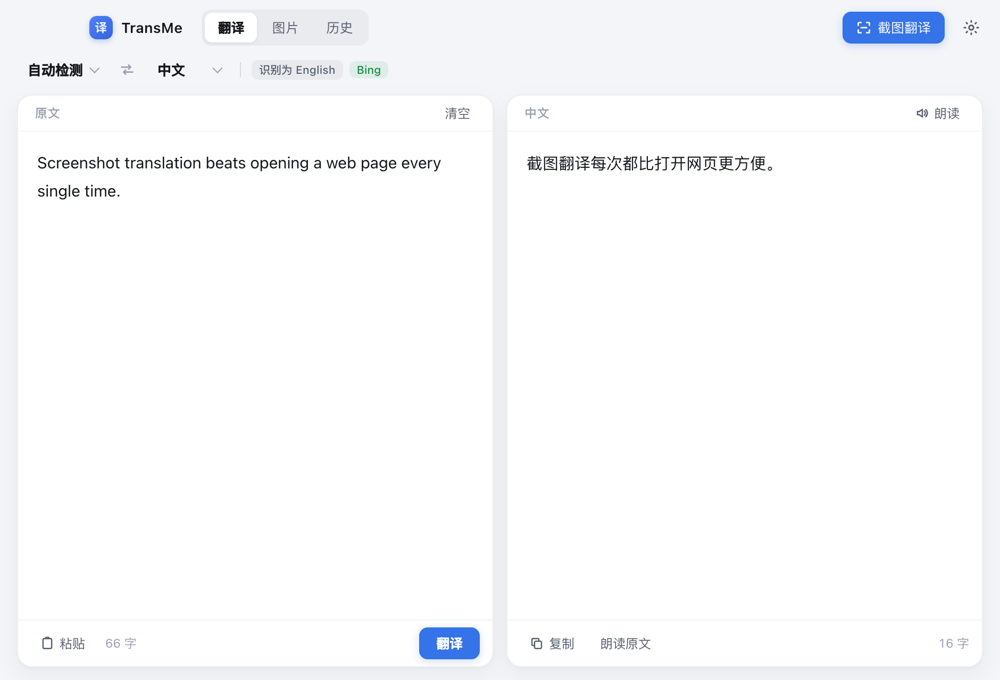
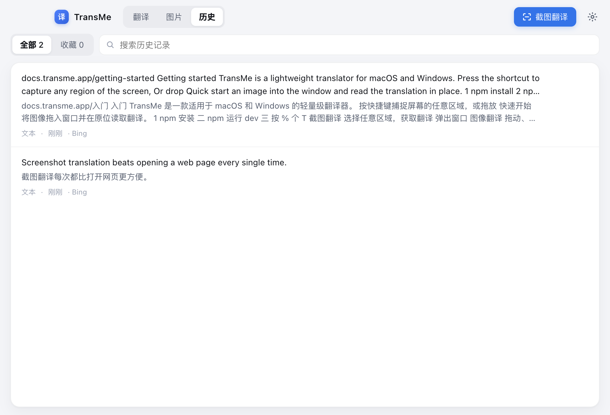
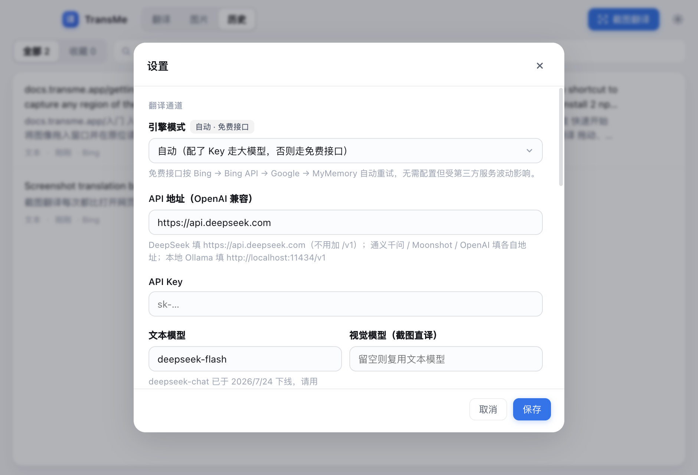

<div align="center">

# TransMe

**截图即译 · 贴图即译 · 菜单栏随手翻** — macOS / Windows 桌面翻译工具，中英日韩泰互译，不用再打开网页

<p>
  
  
  
  
  
  
  
  
</p>



</div>

---

## 为什么又一个翻译工具

网页翻译每次都要切浏览器、粘贴、等广告；装过的客户端要么收费，要么只做文本不做截图，要么把「截图翻译」做成付费会员。

TransMe 想解决的就三件事：

- **不离开当前窗口** —— 菜单栏点一下就能输入；或者把图片**拖进窗口 / ⌘V 粘贴 / 选文件**，译文直接叠回原图对应的文字位置
- **开箱即用** —— 不填任何 API Key 也能用，内置免费通道；想更准再挂自己的大模型
- **不联网也能干活** —— 中英图片走系统自带的离线 OCR，不耗 token、不上传图片

## 功能

| 能力 | 说明 |
| --- | --- |
| **菜单栏快捷翻译** | 菜单栏常驻图标，点一下弹出输入框，任意屏幕 / 全屏应用里都能用；关掉主窗口也还在 |
| **图片翻译** | 拖进来 / ⌘V 粘贴 / 选文件，译文**叠回原图对应位置**，右侧逐行对照；支持 jpg / png / webp |
| **截图翻译** | 全局快捷键 → 全屏框选 → 浮窗出结果，可一键「大图」带进图片翻译继续看 |
| **文本翻译** | 左侧输入即自动翻译（可关），支持中 / 英 / 日 / 韩 / 泰，自动识别源语言 |
| **剪贴板翻译** | 复制任意文本后按快捷键，主窗口直接出译文 |
| **历史与收藏** | 本地保存最近 300 条，可搜索、可收藏、一键回填 |
| **朗读** | 调用系统 TTS 朗读原文 / 译文 |
| **双通道翻译** | 内置免费通道开箱即用；填 API Key 后自动优先大模型（推荐 `deepseek-flash`） |
| **三级 OCR 降级** | 云端 OCR / 本地离线 OCR / 视觉模型，按可用性自动回退，日韩泰也能识别 |
| **纯本地存储** | 历史与设置只写本机 `userData`，无账号、无云端同步、无埋点 |

## 菜单栏快捷翻译

macOS 菜单栏（Windows 是任务栏托盘）常驻一个「文A」图标。点一下弹面板，**不用切窗口、不用找 Dock**：

<p align="center">
  
</p>

- 弹出即聚焦输入框，回车立即翻（或等 0.6 秒自动翻），`Esc` 收起
- 贴着菜单栏图标出现，**在哪块屏幕点就出现在哪块屏幕**，不会把你切走；面板里就能切语言、复制、朗读、进截图翻译
- 「打开主界面」进完整界面；关闭主窗口只是收起来，应用继续驻留菜单栏
- 右键菜单：输入翻译 / 打开主界面 / 截图翻译 / 打开设置 / 退出

## 图片翻译

主窗口切到「图片」页，三种入口：

<p align="center">
  
</p>

| 入口 | 操作 |
| --- | --- |
| 拖放 | 把图片从 Finder / 资源管理器拖进窗口 |
| 粘贴 | `⌘V` / `Ctrl+V`，截图工具、微信、浏览器复制来的图都可以 |
| 选文件 | 点「浏览文件」，支持 jpg / jpeg / png / webp |

识别完成后，译文**按原文字的位置**铺在原图上，右侧是逐行对照：

<p align="center">
  
</p>

- 白底块覆盖原文，字号按文字框自动收缩，长句不会被裁掉半行；不想看叠加就关掉右侧开关
- 点任意一行复制该行译文，底部可整段复制或朗读

## 截图翻译

`⌘⇧T` 唤起全屏框选，松开鼠标后浮窗直接出译文：

<p align="center">
  
  
</p>

浮窗里的「大图」会把这张图带进图片翻译页，继续逐行对照。

## 文本翻译、历史与设置

<p align="center">
  
  
</p>

<p align="center">
  
</p>

## 快捷键

| 操作 | macOS | Windows |
| --- | --- | --- |
| 截图翻译 | `⌘ ⇧ T` | `Ctrl Shift T` |
| 翻译剪贴板内容 | `⌘ ⇧ D` | `Ctrl Shift D` |
| 显示 / 隐藏主窗口 | `⌘ ⇧ Space` | `Ctrl Shift Space` |
| 菜单栏快速翻译 | 点菜单栏图标 | 点托盘图标 |
| 立即翻译 | `⌘ Enter` | `Ctrl Enter` |

快捷键被其他软件占用时注册会失败，设置面板会明确提示。

## 下载安装

到 [Releases](https://github.com/m2lan/trans-me/releases/latest) 下载对应平台的包：

| 平台 | 文件 |
| --- | --- |
| macOS（Intel） | `TransMe-<版本>-x64.dmg` |
| macOS（Apple Silicon） | `TransMe-<版本>-arm64.dmg` |
| Windows 10 / 11（x64） | `TransMe-<版本>-setup.exe` |

macOS 未做 Apple 公证，首次打开若提示「无法验证开发者」，右键 → 打开，或在「系统设置 → 隐私与安全性」里点「仍要打开」。

首次使用截图翻译，系统会申请**屏幕录制**权限：系统设置 → 隐私与安全性 → 屏幕录制 → 勾选 TransMe → **重启应用**（系统限制，必须重启才生效）。

## 快速开始

需要 Node.js 18+。

```bash
git clone https://github.com/m2lan/trans-me.git
cd trans-me
npm install        # 安装 electron / electron-builder / esbuild
npm run dev        # 构建渲染层并启动应用
```

## 打包

```bash
# 本机打包（推荐，不依赖 electron-builder 的 app-builder 二进制）
npm run pack:mac    # → release/mac/TransMe.app + release/TransMe-<版本>-<arch>.dmg

# electron-builder 通道
npm run build:mac   # 生成 dmg（x64 + arm64）
npm run build:win   # 生成 setup.exe
```

`scripts/pack-mac.js` 直接用 Electron 发行版组装：复制运行时 → 改 Info.plist 与辅助进程名 → 写入应用代码 → ad-hoc 签名 → `hdiutil` 出 dmg。产物不带 quarantine 属性，双击即可运行。

图标相关脚本：`npm run icon`（应用图标）、`npm run tray-icon`（菜单栏模板图标）、`npm run social`（社交预览图），都是 AppKit 直接画，无需设计文件。

Windows 安装包建议在 Windows 上执行 `npm run build:win`；在 macOS 上交叉构建需要额外装 wine，稳定性一般。打包配置见 `electron-builder.yml`（`identity: null` 表示不签名，分发给他人的话建议自行签名 / 公证）。

## 翻译通道

设置 → 翻译通道有三种模式：

1. **自动（默认）**：填了 API Key 就走大模型，没填走免费接口。
2. **仅免费接口**：无需任何配置。按 `Bing 网页版 → Bing API → Google → MyMemory` 顺序自动重试，任一成功即返回。
3. **仅大模型**：术语最准，适合专业内容。

免费通道实测：Bing 网页版（`cn.bing.com`）在国内可直连，且带 LLM 增强，质量优于传统机翻；Google 需要网络可达才生效；MyMemory 作为兜底，长文本受配额限制。因此**免费通道适合随手用，长期高频建议填 Key**。

大模型填任何 OpenAI 兼容接口即可（以 DeepSeek 为例）：

```
API 地址  https://api.deepseek.com
API Key   sk-xxxx
文本模型  deepseek-flash
视觉模型  （可留空，留空复用文本模型）
```

> `deepseek-chat` 已于 2026/7/24 下线，请使用 `deepseek-flash`（即 DeepSeek-V4.1-Flash）。DeepSeek 的 base_url 不需要加 `/v1`。

本地 Ollama 填 `http://localhost:11434/v1`，此时不需要 Key。

**DeepSeek 成本参考**（`deepseek-flash`，元/百万 token，空闲 / 高峰）：

| 项目 | 空闲时段 | 高峰时段 |
| --- | --- | --- |
| 输入（缓存命中） | 0.02 | 0.04 |
| 输入（缓存未命中） | 1 | 2 |
| 输出 | 4 | 8 |

高峰指周一至周五 9:00–12:00、14:00–18:00，其余时间（含周末）半价。实测折算：一次 300 字文本翻译约 **0.0012 元**，一次截图翻译（含 OCR）约 **0.0022 元**，每天 200 次翻译 + 50 张截图约 **0.35 元**。

## 截图识别（OCR）

三条通道，设置里可分别开关，按顺序自动降级：

| 通道 | 说明 |
| --- | --- |
| **云端 OCR** | 走 DeepSeek `POST /v1/tools/ocr`，先识别文字再翻译。中英日韩泰全覆盖，**1.5 元/千页**（一张图 0.0015 元），仅在 API 地址是 DeepSeek 且填了 Key 时启用 |
| **视觉模型直译** | 图片直接交给视觉模型，返回原文 + 译文，版式复杂的图效果最好；只有整段译文，没有每行位置 |
| **本地离线 OCR** | macOS 调系统 Vision（`osascript` 桥接，免编译免 Xcode），Windows 调 `Windows.Media.Ocr`（需装对应语言包）。免费、离线，并返回每行文字位置 |

两条链路的选择顺序略有差别，原因是要不要「每行位置」：

- **截图翻译**：`云端 OCR → 视觉模型直译 → 本地 OCR` —— 只要能出文字就行，优先质量
- **图片翻译**：`云端 OCR → 本地 OCR → 视觉模型` —— 前两者能给出每行文字框，才能把译文叠回原位；视觉模型只能整段输出

本地 OCR 支持语种（决定要不要配 Key）：

| 系统 | 本地 OCR 支持语种 |
| --- | --- |
| macOS 12~13 | 中文（简/繁）、英文 |
| macOS 14+ | 中文、英文、日文、韩文 |
| Windows 10/11 | 取决于已安装的语言包，通常中英日韩齐备 |

因此在 macOS 12/13 上要识别日 / 韩 / 泰图片，请开启云端 OCR 或配置视觉模型。

## 目录结构

```
electron/          主进程
  main.js          窗口、菜单栏图标、截图遮罩、结果浮窗、全局快捷键
  preload.js       渲染层 API 桥
  translate.js     翻译引擎（Bing / Google / MyMemory / LLM / 视觉模型）
  image.js         图片翻译流水线（图片 → OCR 分段 → 逐行翻译）
  ocr.js           OCR 调度（DeepSeek 云端 OCR / macOS Vision / Windows OCR）
  tts.js           系统朗读
  store.js         设置与历史（userData/store.json）
src/               渲染层（Vue 3，无构建框架，esbuild 直接打包）
  components/      App / LangBar / ImagePane / HistoryPanel / SettingsModal
  vendor/          Vue 运行时（打包进产物，无需联网）
  overlay.*        截图框选遮罩
  popup.*          翻译结果浮窗
  tray.*           菜单栏小面板
native/
  ocr-mac.js       macOS Vision OCR（JXA）
  ocr-windows.ps1  Windows OCR（WinRT）
scripts/
  build.js         esbuild 打包渲染层
  dev.js           构建 + 启动 Electron
  pack-mac.js      组装 .app 并出 dmg
  make-icon.js     应用图标（icns）
  make-tray-icon.js 菜单栏模板图标
  make-social.js   社交预览图
test/              探针与端到端校验脚本（CDP 驱动真实应用）
```

## 常见问题

<details>
<summary><b>点菜单栏图标会不会把桌面切回主屏？</b></summary>

不会。面板是 macOS 的 NSPanel（nonactivating），浮起时不激活应用，所以停在当前这块屏幕的当前桌面。这是 1.3.0 的 bug，1.3.1 已修。
</details>

<details>
<summary><b>截图翻译没反应 / 黑屏？</b></summary>

macOS 需要在「隐私与安全性 → 屏幕录制」里授权并**重启应用**。截图只覆盖鼠标所在那块屏幕，先把鼠标移到目标屏再按快捷键。
</details>

<details>
<summary><b>免费通道偶发失败？</b></summary>

免费通道依赖第三方公开接口，服务端改版时会短时失效，下次会自动切下一条。长期高频使用建议在设置里填自己的 API Key。
</details>

<details>
<summary><b>不填 Key 能识别日 / 韩 / 泰图片吗？</b></summary>

取决于系统：macOS 14+ 与 Windows（装有对应语言包）可以用本地 OCR；macOS 12/13 的系统 Vision 只有中英文，需要开云端 OCR 或视觉模型。
</details>

<details>
<summary><b>为什么会话关掉了，应用还在？</b></summary>

它常驻菜单栏。要彻底退出：点菜单栏图标右键 → 「退出 TransMe」，或 `⌘Q`。
</details>

<details>
<summary><b>支持 Linux 吗？</b></summary>

代码上窗口与快捷键是跨平台的，截图与 OCR 依赖平台能力（macOS Vision / Windows WinRT）。Linux 需要另接截图与 OCR 后端，目前未适配。
</details>

<details>
<summary><b>会把我翻译的内容上传到哪里？</b></summary>

历史与设置只存本机。文本会发给你选择的翻译通道（免费接口或自己配置的大模型）；中英图片走本地 OCR 时不发图，只有开启云端 OCR / 视觉模型才会把图片传给对应服务商。
</details>

<details>
<summary><b>支持划词即译（选中文本直接出译文）吗？</b></summary>

当前是「复制后按快捷键」或菜单栏面板输入，不监听鼠标选区（避免常驻钩子影响其他应用）。需要的话可以提 issue。
</details>

## 已知限制

- 截图只覆盖鼠标所在的那块屏幕，多显示器需要移动鼠标到目标屏再按快捷键。
- 菜单栏面板不会强行覆盖其他应用的全屏画面（macOS 对全屏 Space 的限制），先显示菜单栏再点图标。
- 免费通道依赖第三方接口，服务端改版时可能短时失效，不影响大模型通道。
- 未做术语库 / 文档翻译（PDF 整篇），当前定位是「随手翻译」。
- 未做 OCR 之外的版式还原（表格、公式会按纯文本顺序输出）。
- Windows 的托盘面板尚未在真机验证（开发与测试都在 macOS 上完成，逻辑是跨平台的，但没有实机跑过）。

## 参与贡献

欢迎 issue 与 PR，提交前请先看 [CONTRIBUTING.md](CONTRIBUTING.md)。版本变更见 [CHANGELOG.md](CHANGELOG.md)。

如果这个工具帮你省了时间，点个 ⭐ 是最直接的鼓励。

## License

[MIT](LICENSE) © 2026 m2lan

---

<div align="center">

### English

**TransMe** is a lightweight desktop translator for macOS and Windows. Click the menu bar icon to translate on the spot, drop or paste an image to get the translation overlaid on the original text positions, or press a shortcut to capture any region of the screen. Chinese / English / Japanese / Korean / Thai, with offline OCR (macOS Vision, Windows.Media.Ocr) and optional cloud OCR or any OpenAI-compatible LLM. Built with Electron + Vue 3, no account, everything stored locally.

*Keywords: screen translation, screenshot translator, image translator, OCR translation, menu bar translator, clipboard translator, deepseek translator, offline OCR.*

</div>
