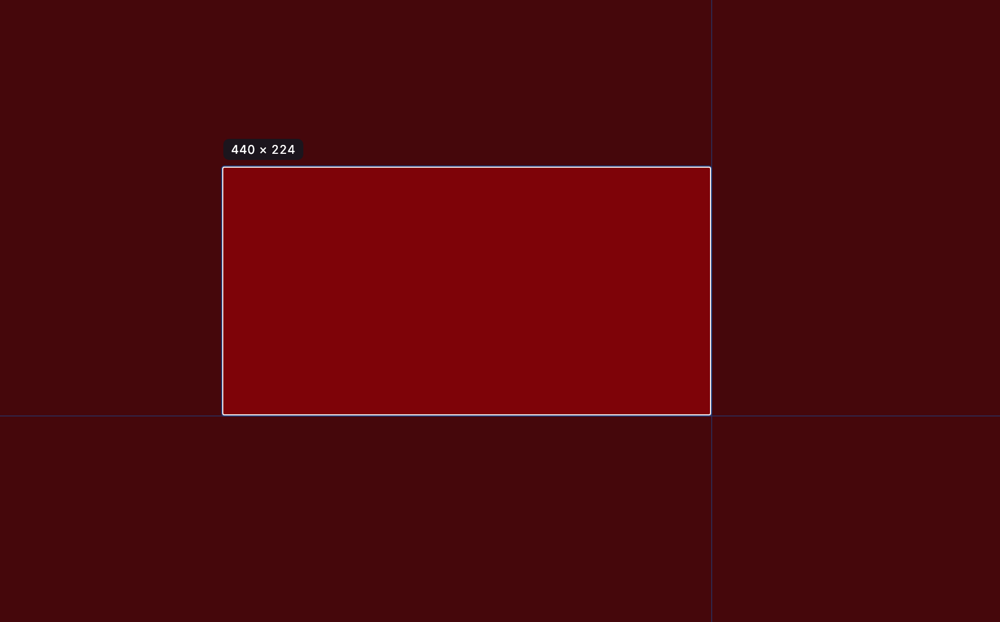
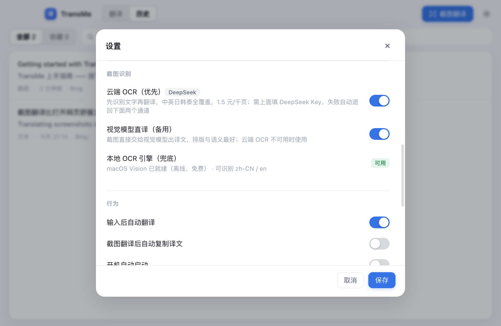

# TransMe

轻量桌面翻译工具，macOS / Windows 同一套代码。中英日韩泰互译，主打**截图即译**，不用再打开网页。


<p align="center">
  
  
</p>

## 功能

| 能力 | 说明 |
| --- | --- |
| 文本翻译 | 左侧输入即自动翻译（可关），支持中 / 英 / 日 / 韩 / 泰，自动识别源语言 |
| 截图翻译 | 全局快捷键 → 全屏框选 → 识别文字 → 浮窗出译文 |
| 划词 / 剪贴板翻译 | 复制任意文本后按快捷键，直接在主窗口出译文 |
| 历史与收藏 | 本地保存最近 300 条，可搜索、收藏、一键回填 |
| 朗读 | 调用系统 TTS 朗读原文 / 译文 |
| 双通道引擎 | 内置免费通道开箱即用；填 API Key 后自动优先大模型（推荐 `deepseek-flash`） |
| 三通道 OCR | 云端 OCR → 视觉模型 → 本地离线，逐级降级 |

## 快捷键

| 操作 | macOS | Windows |
| --- | --- | --- |
| 截图翻译 | `⌘ ⇧ T` | `Ctrl Shift T` |
| 翻译剪贴板内容 | `⌘ ⇧ D` | `Ctrl Shift D` |
| 显示 / 隐藏主窗口 | `⌘ ⇧ Space` | `Ctrl Shift Space` |
| 立即翻译 | `⌘ Enter` | `Ctrl Enter` |

快捷键被其他软件占用时注册会失败，设置面板会提示。

## 快速开始

```bash
npm install        # 安装 electron / electron-builder / esbuild
npm run dev        # 构建渲染层并启动应用
```

首次使用截图翻译，macOS 会申请「屏幕录制」权限：系统设置 → 隐私与安全性 → 屏幕录制 → 勾选 TransMe → 重启应用。

## 打包

```bash
# 本机打包（推荐，不依赖 electron-builder）
npm run pack:mac    # → release/mac/TransMe.app + release/TransMe-1.1.0-x64.dmg

# electron-builder 通道
npm run build:mac   # 生成 release/TransMe-1.1.0.dmg（x64 + arm64）
npm run build:win   # 生成 release/TransMe-1.1.0-setup.exe
```

`scripts/pack-mac.js` 直接用 Electron 发行版组装：复制运行时 → 改 Info.plist 与辅助进程名 → 写入应用代码 → ad-hoc 签名 → `hdiutil` 出 dmg。产物不带 quarantine 属性，双击即可运行，不需要在「隐私与安全性」里额外放行。

图标由 `npm run icon` 生成（AppKit 绘制 → `build/icon.icns`）。

跨平台构建说明：Windows 安装包建议在 Windows 上执行 `npm run build:win`；在 macOS 上交叉构建 Windows 包需要额外安装 wine，稳定性一般。

打包配置见 `electron-builder.yml`（`identity: null` 表示不签名，本地自用足够；分发给他人的话建议自行签名/公证）。

## 翻译通道

设置 → 翻译通道有三种模式：

1. **自动（默认）**：填了 API Key 就走大模型，没填走免费接口。
2. **仅免费接口**：无需任何配置。按 `Bing 网页版 → Bing API → Google → MyMemory` 顺序自动重试，任一成功即返回。
3. **仅大模型**：术语最准，适合专业内容。

免费通道实测：Bing 网页版（`cn.bing.com`）在国内可直连，且带 LLM 增强，质量优于传统机翻；Google 需要网络可达才生效；MyMemory 作为兜底，长文本受配额限制。因此**免费通道适合随手用，长期高频建议填 Key**。

大模型填任何 OpenAI 兼容接口即可（以 DeepSeek 为例）：

```
API 地址  https://api.deepseek.com
API Key   sk-xxxx
文本模型  deepseek-flash
视觉模型  （可留空，留空复用文本模型）
```

> `deepseek-chat` 已于 2026/7/24 下线，请使用 `deepseek-flash`（即 DeepSeek-V4.1-Flash）。DeepSeek 的 base_url 不需要加 `/v1`。

本地 Ollama 填 `http://localhost:11434/v1`，此时不需要 Key。

**DeepSeek 成本参考**（`deepseek-flash`，元/百万 token，空闲 / 高峰）：

| 项目 | 空闲时段 | 高峰时段 |
| --- | --- | --- |
| 输入（缓存命中） | 0.02 | 0.04 |
| 输入（缓存未命中） | 1 | 2 |
| 输出 | 4 | 8 |

高峰指周一至周五 9:00–12:00、14:00–18:00，其余时间（含周末）半价。实测折算：一次 300 字文本翻译约 **0.0012 元**，一次截图翻译（含 OCR）约 **0.0022 元**，每天 200 次翻译 + 50 张截图约 **0.35 元**。

## 截图识别（OCR）

按优先级自动降级，设置里可分别开关：



1. **云端 OCR（优先）**：走 DeepSeek `POST /v1/tools/ocr`，先识别文字再翻译。中英日韩泰全覆盖，按页计费 **1.5 元/千页**（一张截图 0.0015 元）。仅当 API 地址是 DeepSeek 且填了 Key 时启用。
2. **视觉模型直译**（备用）：截图直接交给视觉模型，返回原文 + 译文，排版与语义最好。
3. **本地离线 OCR**（兜底）：
   - macOS：调用系统 Vision 框架（通过 `osascript` 的 ObjC 桥接，无需编译、无需装 Xcode）。
   - Windows：调用系统 `Windows.Media.Ocr`，需要系统装有对应语言包（设置 → 时间和语言 → 语言 → 添加语言功能）。

能力差异（实测）：

| 系统 | 本地 OCR 支持语种 |
| --- | --- |
| macOS 12~13 | 中文（简/繁）、英文 |
| macOS 14+ | 中文、英文、日文、韩文 |
| Windows 10/11 | 取决于已安装的语言包，通常中英日韩齐备 |

因此在 macOS 12/13 上要识别日 / 韩 / 泰截图，请开启云端 OCR 或配置视觉模型。

## 目录结构

```
electron/          主进程
  main.js          窗口、截图遮罩、结果浮窗、全局快捷键
  preload.js       渲染层 API 桥
  translate.js     翻译引擎（Bing / Google / MyMemory / LLM / 视觉模型）
  ocr.js           OCR 调度（DeepSeek 云端 OCR / macOS Vision / Windows OCR）
  tts.js           系统朗读
  store.js         设置与历史（userData/store.json）
src/               渲染层（Vue 3，无构建框架，esbuild 直接打包）
  components/      App / LangBar / HistoryPanel / SettingsModal
  vendor/          Vue 运行时（打包进产物，无需联网）
  overlay.*        截图框选遮罩
  popup.*          翻译结果浮窗
native/
  ocr-mac.js       macOS Vision OCR（JXA）
  ocr-windows.ps1  Windows OCR（WinRT）
scripts/
  build.js         esbuild 打包渲染层
  dev.js           构建 + 启动 Electron
```

## 已知限制

- 截图只覆盖鼠标所在的那块屏幕，多显示器需要移动鼠标到目标屏再按快捷键。
- 免费通道依赖第三方接口，服务端改版时可能短时失效，不影响大模型通道。
- 未做术语库 / 文档翻译（PDF 整篇），当前定位是「随手翻译」。
